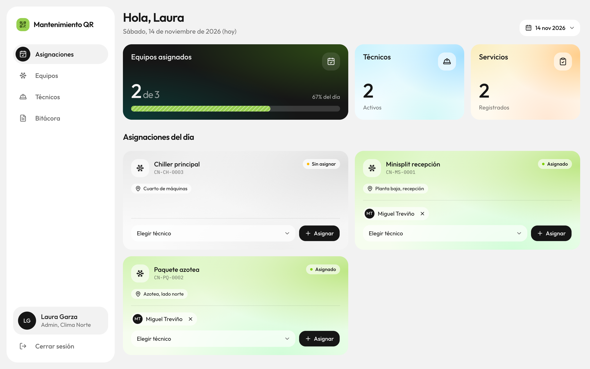
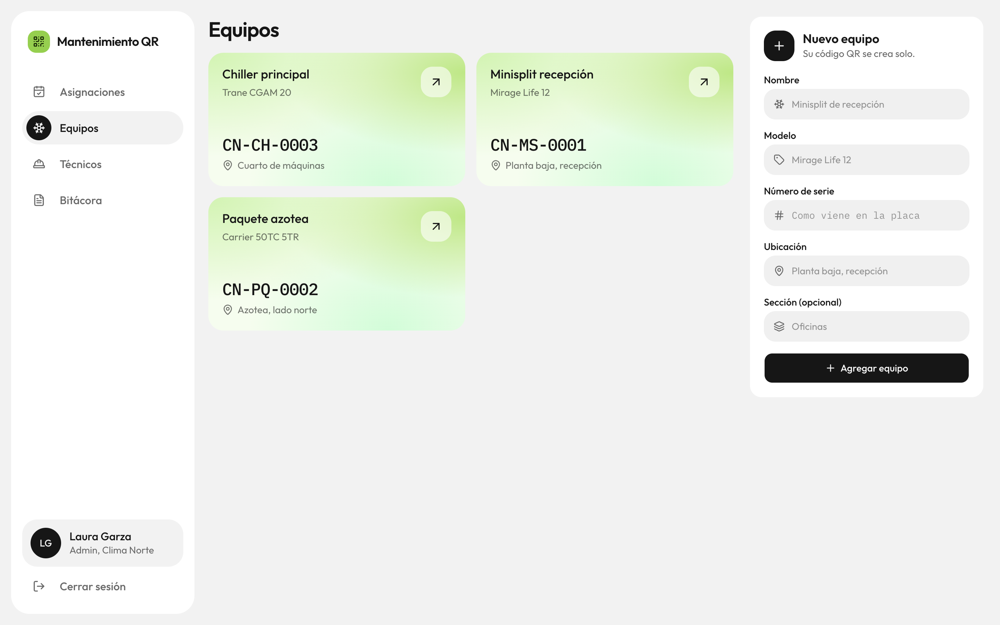
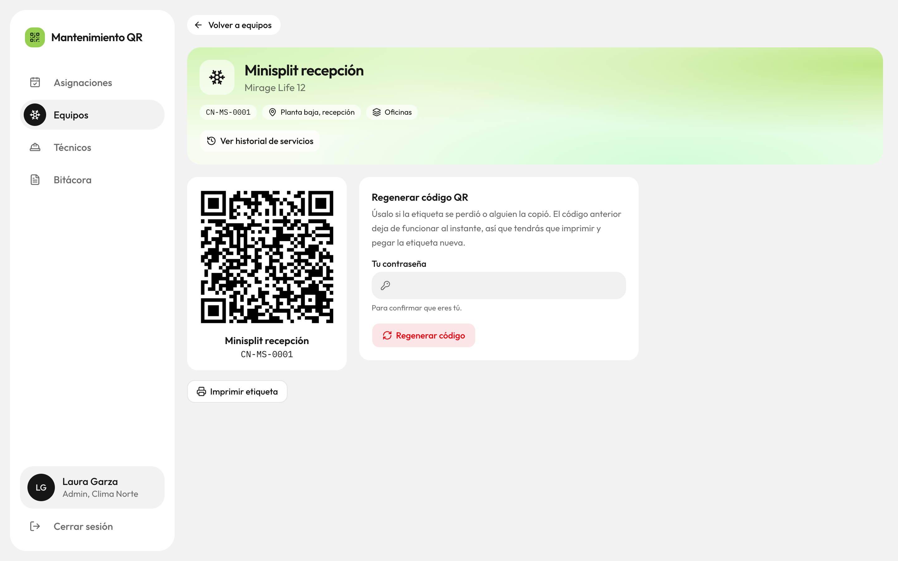
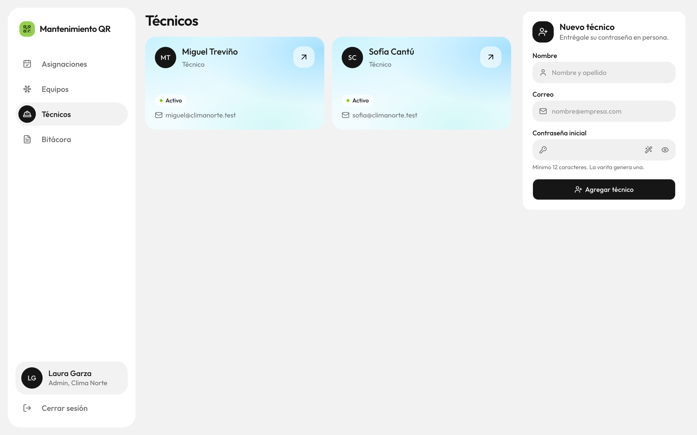
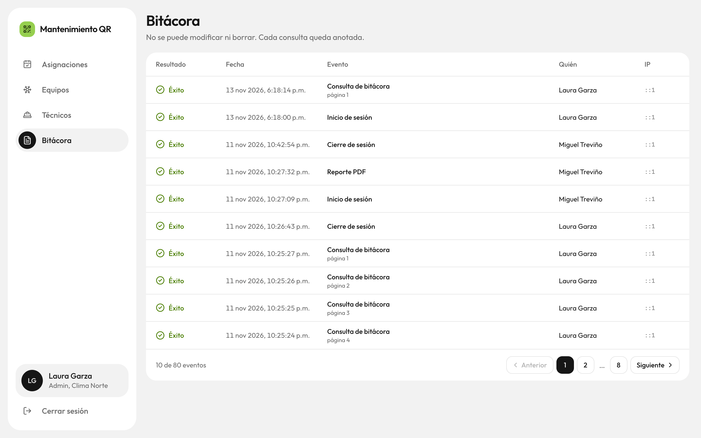
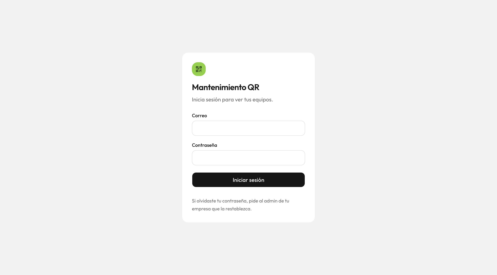
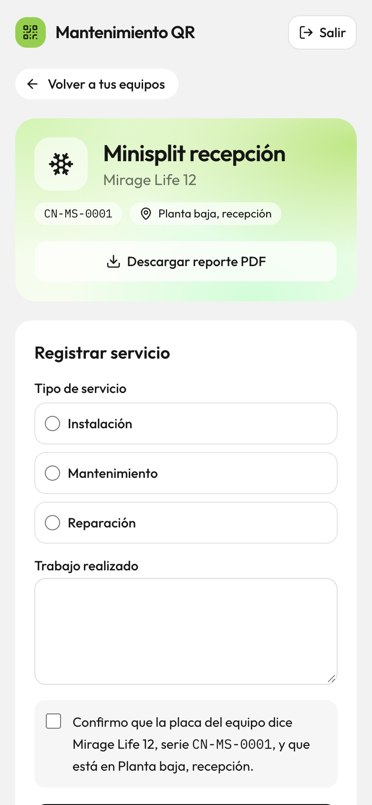

<div align="center">

# Mantenimiento QR

Historial de mantenimiento de equipos de clima y refrigeración, consultable al escanear el código QR pegado en cada equipo.


Proyecto Integrador Académico de **Desarrollo de Software Seguro**, FCFM UANL.



</div>

## De qué trata

En muchas empresas de servicio técnico el historial de cada equipo vive en reportes de papel que se pierden y no se pueden consultar en campo. Este sistema lo centraliza: cada equipo tiene un código QR y, al escanearlo, el técnico ve su historial y registra el trabajo que hizo.

El proyecto es pequeño a propósito. Lo importante no es la cantidad de funciones, sino que cada decisión de seguridad esté justificada y se pueda demostrar.

## Qué hace

- **Dos roles.** El administrador gestiona técnicos, equipos y asignaciones; el técnico atiende los equipos que tiene asignados ese día.
- **Varias empresas aisladas.** Nadie puede ver ni tocar los datos de otra empresa.
- **Escaneo de QR.** Cada etiqueta lleva un token aleatorio que el administrador puede regenerar si se pierde.
- **Historial que no se borra.** Corregir o anular un servicio crea un registro nuevo; el original siempre se conserva.
- **Bitácora de auditoría** de accesos, cambios y escaneos.
- **Reporte en PDF** del historial de cada equipo.

## Seguridad

| Mecanismo | Qué protege |
| --- | --- |
| Contraseñas con Argon2id y límite de intentos | Ataques de fuerza bruta |
| Sesiones en la base de datos, revocables al instante | Sesiones robadas o técnicos dados de baja |
| Una sola capa de datos que filtra por empresa | Acceso a datos de otra empresa |
| Triggers que bloquean cambios en servicios y bitácora | Alteración del historial |
| Validación con Zod, política CSP y PDF en texto plano | Inyección y XSS |
| Errores genéricos y cabeceras de seguridad | Fuga de información interna |

## Capturas

| Equipos | Etiqueta QR |
| --- | --- |
|  |  |
| **Técnicos** | **Bitácora** |
|  |  |

| Inicio de sesión | Vista del técnico en el celular |
| --- | --- |
|  |  |

## Cómo correrlo

Necesitas Node.js 20 o superior.

```bash
npm install
cp .env.example .env        # define SEED_PASSWORD y APP_URL
npx prisma migrate dev      # crea la base de datos
npx prisma db seed          # carga dos empresas de prueba
npm run dev                 # http://localhost:3000
```

El seed crea dos empresas ficticias, cada una con un administrador y dos técnicos. Todas las cuentas usan la contraseña que pongas en `SEED_PASSWORD`.

### Cuentas de prueba

| Empresa | Rol | Correo |
| --- | --- | --- |
| Clima Norte | Administrador | `laura@climanorte.test` |
| Clima Norte | Técnico | `miguel@climanorte.test` |
| Clima Norte | Técnico | `sofia@climanorte.test` |
| Frío Regio | Administrador | `carlos@frioregio.test` |
| Frío Regio | Técnico | `ana@frioregio.test` |
| Frío Regio | Técnico | `jorge@frioregio.test` |

Para probar rápido, entra como Laura para ver el panel del administrador y como Miguel para ver la vista del técnico. Los equipos del técnico dependen de las asignaciones del día, así que si no ve ninguno, asígnaselos primero desde el panel de Laura.

Para las pruebas y la revisión de código:

```bash
npm test
npm run lint
```

## Equipo

| Integrante | Rol |
| --- | --- |
| Cesar Oziel Guajardo Rodríguez | Coordinación y documentación |
| Johan Joel Rodríguez Medina | Backend y autenticación |
| Brandon Jahir Reyna Marroquín | Frontend, QR y PDF |
| Diego Ángel Torres Azua | Verificación y seguridad |
