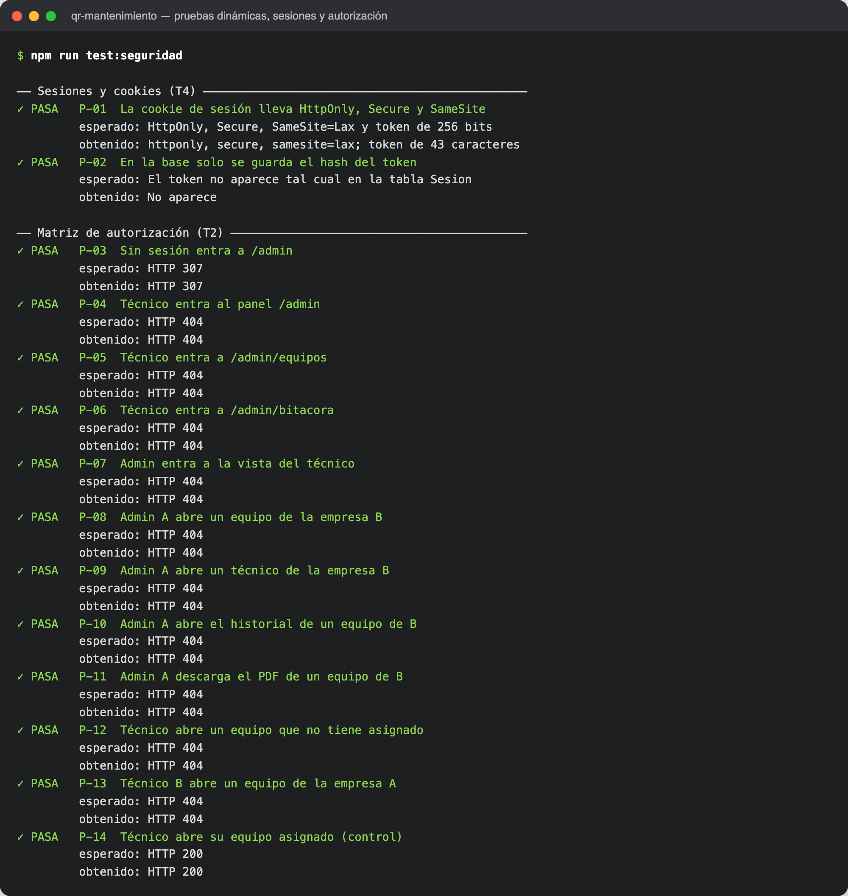
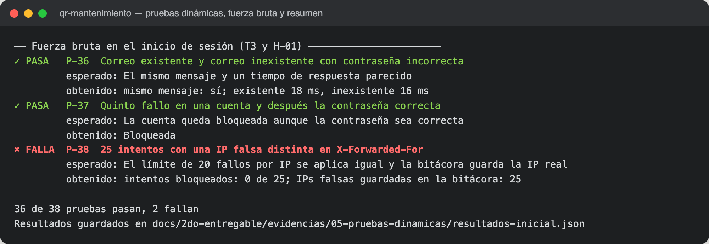

# 1. Autenticación, autorización y control de acceso

Aquí explicamos cómo el sistema comprueba quién es cada usuario y qué puede hacer según su rol y su empresa. Las pruebas que lo demuestran están en la carpeta 05.

## Inicio de sesión

| Mecanismo | Dónde está | Prueba |
| --- | --- | --- |
| Contraseñas guardadas como hash Argon2id | lib/auth/password.ts | Ver carpeta 10 |
| Mismo mensaje y mismo tiempo si el correo existe o no | lib/auth/password.ts y app/login/acciones.ts | P-36 |
| Bloqueo de la cuenta al quinto fallo en 15 minutos | lib/auth/limite.ts | P-37 |
| Bloqueo de la dirección IP al vigésimo fallo | lib/auth/limite.ts y server.mjs | P-38 |
| Contraseñas de 12 a 200 caracteres y sin contraseñas comunes | lib/auth/reglas.ts | Pruebas unitarias |

## Sesiones

La sesión vive en la base de datos. El navegador recibe un token aleatorio de 256 bits en una cookie HttpOnly, Secure y SameSite=Lax, y en la base solo guardamos su hash.

| Rol | Expira por inactividad | Expiración absoluta |
| --- | --- | --- |
| Técnico | 8 horas | 7 días |
| Administrador | 30 minutos | 12 horas |

La sesión se borra al cerrar sesión (P-35), al desactivar al usuario (P-34) y al cambiar su contraseña. Las acciones sensibles del administrador, como dar de baja a un técnico o regenerar un QR, piden la contraseña otra vez.

## Autorización

- Todo el acceso a datos pasa por lib/datos, que revisa el rol y filtra por la empresa de la sesión. La empresa nunca viene del navegador (P-08 a P-16).
- Un técnico solo abre los equipos que tiene asignados ese día (P-12 a P-14).
- Algo que no existe y algo sin permiso responden con la misma página de no encontrado (P-03 a P-07).
- Las acciones del servidor de Next.js solo aceptan peticiones del mismo origen, lo que junto con la cookie SameSite protege contra CSRF.

## Códigos QR

- El token del QR es aleatorio, de 256 bits y distinto del identificador del equipo.
- Sin sesión, un QR real y uno inventado responden igual (P-32).
- Después de 20 códigos inválidos el usuario queda bloqueado un rato (P-33).

## Evidencia

