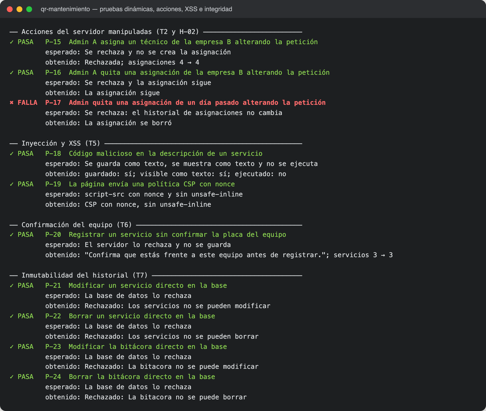
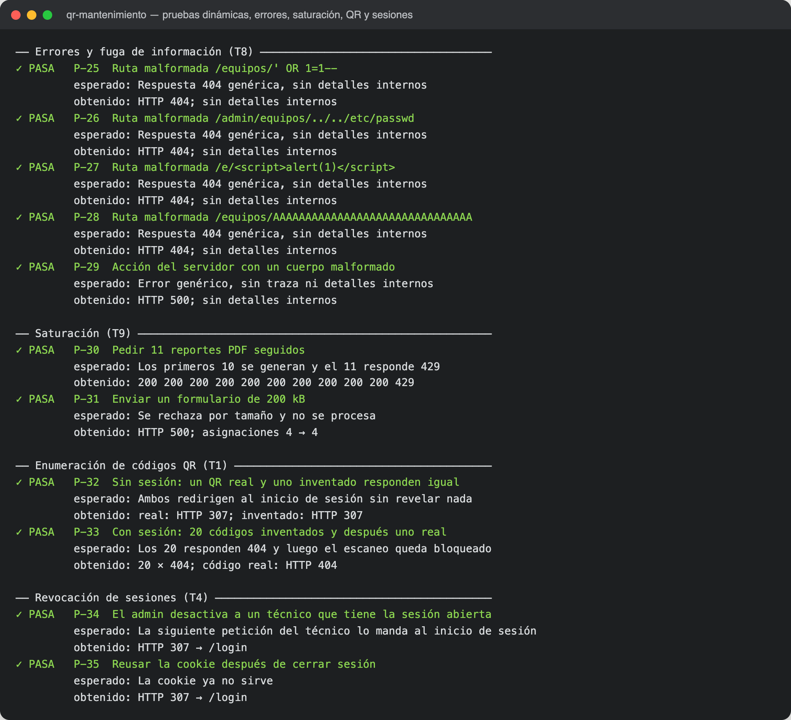

# 2. Validación y procesamiento seguro de datos

Aquí explicamos cómo el sistema revisa todo lo que escriben los usuarios y cómo maneja los errores sin dar información de más.

## Validación de entradas

Todo lo que llega de un formulario pasa por un esquema de Zod en lib/validacion.ts antes de tocar la base.

| Campo | Regla |
| --- | --- |
| Descripción del servicio | Texto de 5 a 2000 caracteres |
| Motivo de corrección o anulación | Texto de 5 a 500 caracteres, obligatorio |
| Nombre, modelo y ubicación | Texto de 1 a 120 caracteres según el campo |
| Correo | Formato de correo, máximo 254 caracteres |
| Tipo de servicio | Solo valores de una lista fija |
| Fecha de asignación | Fecha real y no pasada |
| Destino después del login | Solo rutas de QR, para evitar redirecciones a otros sitios |

## Qué más hacemos

| Mecanismo | Dónde está | Prueba |
| --- | --- | --- |
| Consultas parametrizadas con Prisma | lib/datos | P-25 a P-28 |
| Salida escapada por React y política CSP con nonce | proxy.ts | P-18 y P-19 |
| PDF con plantilla fija y el texto del usuario como texto plano | lib/pdf.ts | P-30 |
| Máximo 10 reportes PDF cada 10 minutos por usuario | lib/auth/limite.ts | P-30 |
| Formularios de máximo 100 kB | next.config.ts | P-31 |
| Peticiones malformadas sin romper el servidor | Next.js | P-29 |
| Confirmación de la placa antes de registrar un servicio | lib/validacion.ts | P-20 |
| Servicios y bitácora que no se pueden editar ni borrar | Disparadores en prisma/migrations | P-21 a P-24 |

Las correcciones y anulaciones de un servicio no cambian el registro original: se guardan como registros nuevos con un motivo obligatorio.

## Evidencia

