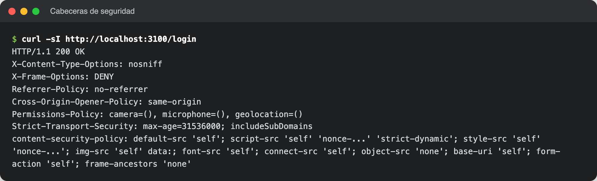

# 3. Protección de información sensible

Aquí explicamos cómo protegemos las contraseñas, las sesiones, los secretos de la aplicación y los datos de las empresas.

| Información | Cómo la protegemos |
| --- | --- |
| Contraseñas | Solo se guarda su hash Argon2id con una sal distinta por cuenta. Nunca se escriben en la bitácora ni en los registros |
| Tokens de sesión | En la base solo está su hash SHA-256 y la cookie no se puede leer desde JavaScript |
| Tokens de QR | Solo los ve el administrador de la empresa. La cabecera Referrer-Policy evita que la dirección del QR se mande a otros sitios |
| Datos de cada empresa | Separados por el filtro de empresa de la capa de datos |
| Secretos | Viven en .env, que no se sube al repositorio. Solo subimos .env.example sin valores reales, y gitleaks revisa el historial en cada push |
| Base de datos | El archivo .db tampoco se sube al repositorio |
| Errores | El usuario ve un mensaje genérico con un código; el detalle queda solo en el servidor |
| Reporte PDF | Solo trae los datos del equipo y su historial, sin correos ni datos de usuarios |

La bitácora guarda quién hizo qué, cuándo, en qué empresa, con qué resultado y desde qué dirección, pero nunca contraseñas, tokens ni el contenido de los servicios.

## Cabeceras de seguridad

Estas son las cabeceras que manda el servidor. Para la captura filtramos solo las de seguridad y ocultamos el nonce, porque cambia en cada petición.

## Algo que corregimos

El script que llena la base con datos de prueba calculaba un solo hash y lo usaba para todas las cuentas, así que todas tenían la misma sal y se notaba que compartían contraseña. Las cuentas creadas desde la aplicación no tenían este problema, pero lo corregimos para que cada cuenta de prueba tenga su propia sal. Se puede ver en la carpeta 10.
