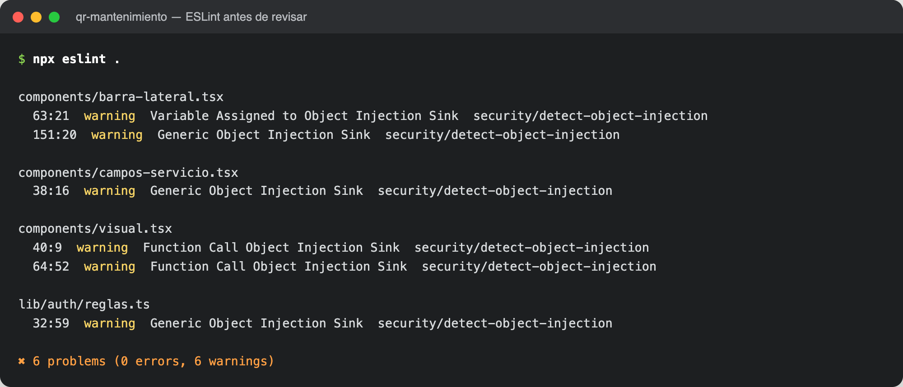
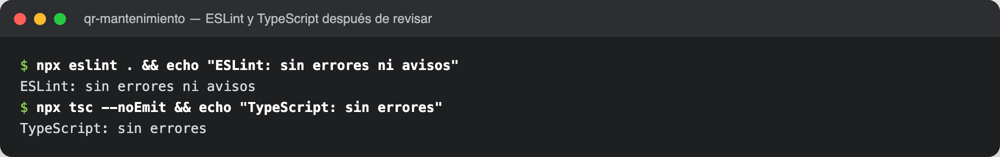
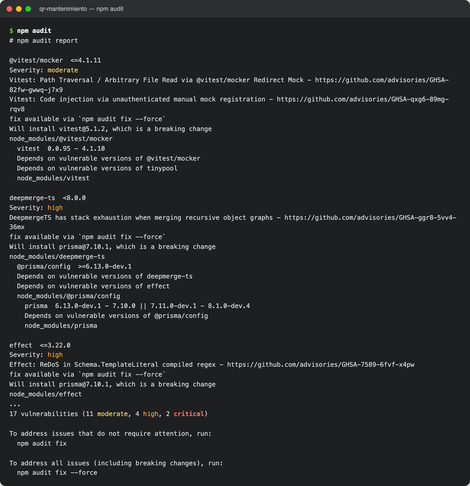
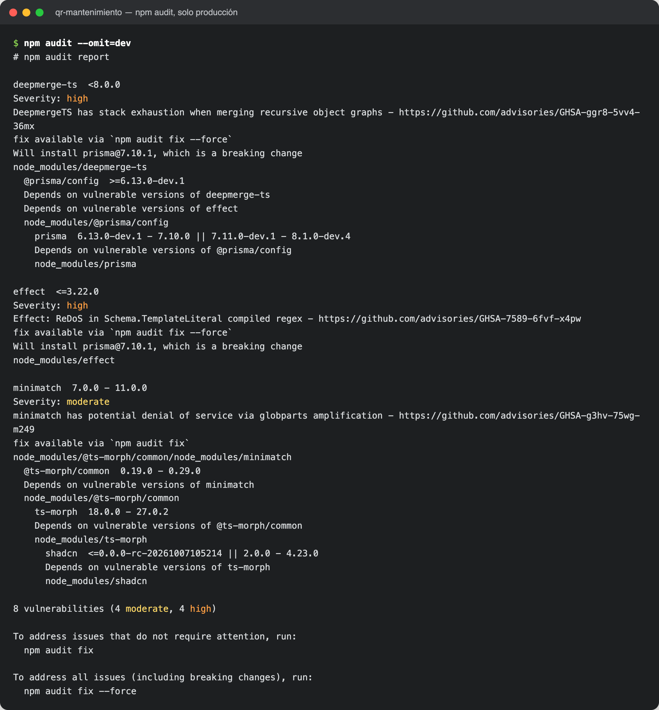
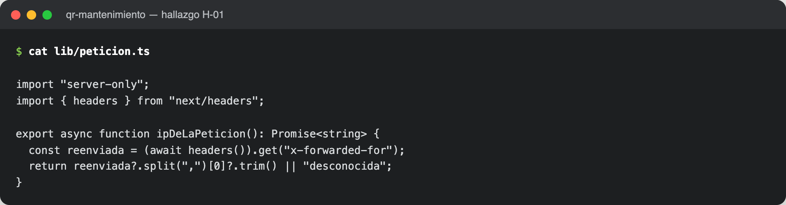
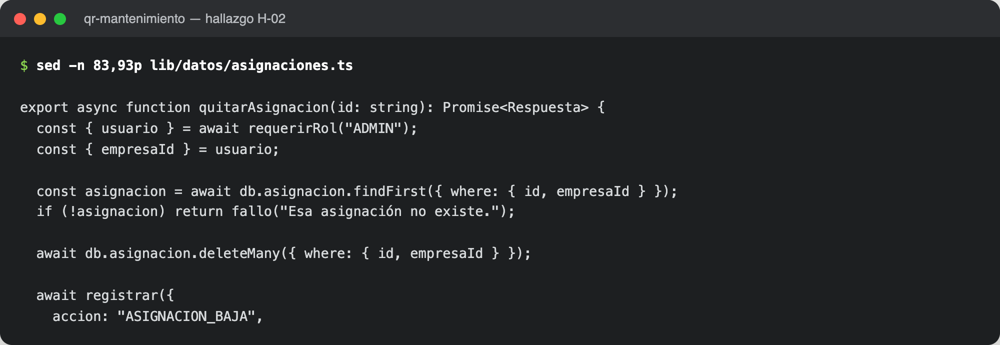

# 4. Análisis estático y de dependencias

Antes de corregir cualquier cosa revisamos el código sin ejecutarlo, buscando patrones que suelen causar vulnerabilidades, y revisamos también las librerías externas que usa el proyecto. Lo hicimos el 25 de noviembre de 2026 para tener un punto de partida.

## Qué usamos

| Herramienta | Para qué la usamos |
| --- | --- |
| ESLint con eslint-plugin-security | Buscar código peligroso, como el uso de eval o expresiones regulares vulnerables |
| Compilador de TypeScript | Detectar errores de tipos en todo el proyecto |
| npm audit | Revisar si las librerías tienen vulnerabilidades conocidas |
| Revisión manual | Revisar a mano la autorización, las sesiones y los datos que llegan en cada petición |

## Análisis del código

ESLint encontró 6 avisos y ningún error. Los seis vienen de una regla que avisa cada vez que se lee un objeto con una clave variable, porque si esa clave la controlara un atacante podría leer datos internos.

Revisamos los seis casos uno por uno y todos resultaron ser falsos positivos. En cada uno la clave solo puede tomar unos pocos valores fijos, como el rol del usuario o el tipo de servicio, y nunca viene directamente de lo que envía el usuario. Dejamos un comentario en el código explicando por qué cada caso es seguro, y así el análisis quedó limpio.

## Revisión de las librerías

npm audit encontró 17 librerías con vulnerabilidades conocidas: 2 críticas, 4 altas y 11 moderadas.

Al revisar de dónde venía cada una nos dimos cuenta de que no todas tienen el mismo peso. Las dos críticas están en una librería que solo usa la herramienta de pruebas, así que no llegan al sistema que usan los clientes. Si nos quedamos solo con las librerías que sí llegan a producción, el número baja a 8.

| Librería | Severidad | Dónde se usa |
| --- | --- | --- |
| tinypool, que llega por vitest | Crítica | Solo en las pruebas |
| vitest | Moderada | Solo en las pruebas |
| deepmerge-ts y effect, que llegan por prisma | Alta | Producción |
| minimatch, que llega por shadcn y por las reglas de ESLint | Moderada | Producción y pruebas |

## Lo que encontramos

Además de lo que marcaron las herramientas, la revisión manual nos dejó dos problemas que ninguna herramienta había detectado.

| ID | Hallazgo | Severidad |
| --- | --- | --- |
| H-01 | La dirección IP de quien hace la petición se toma de una cabecera que el propio usuario puede inventar. Con eso un atacante podría esquivar el límite de intentos de inicio de sesión y dejar direcciones falsas en la bitácora. | Media |
| H-02 | La pantalla solo deja quitar asignaciones de hoy en adelante, pero el servidor no lo revisa. Una petición hecha a mano podría borrar asignaciones de días pasados. | Baja |
| H-03 | shadcn, una herramienta que solo usamos para crear componentes, quedó instalada como librería de producción sin necesidad. | Baja |
| H-04 | Hay 17 librerías con vulnerabilidades conocidas, dos de ellas críticas. | Alta |

Antes de corregir estos hallazgos los comprobamos con pruebas reales, que están en la carpeta 05.

## Archivos de esta carpeta

- **eslint-inicial.json**: resultado completo de ESLint.
- **npm-audit-inicial.json**: resultado completo de npm audit.
