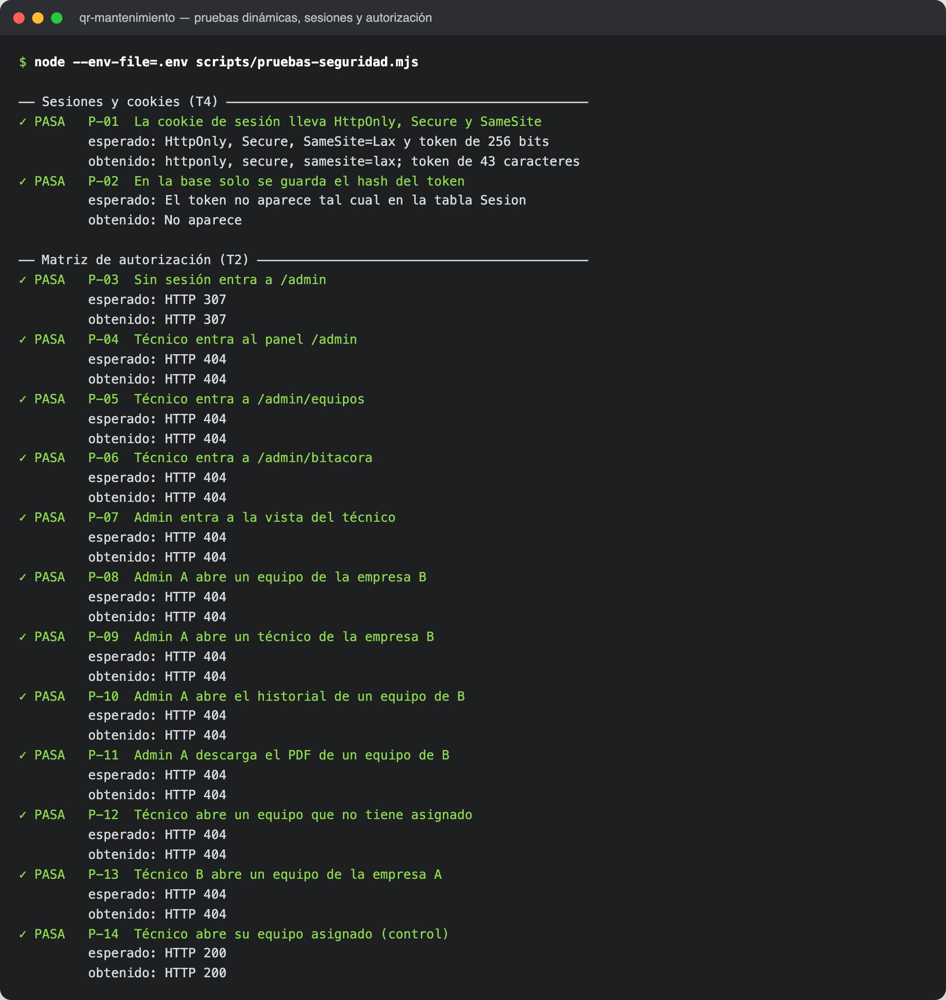
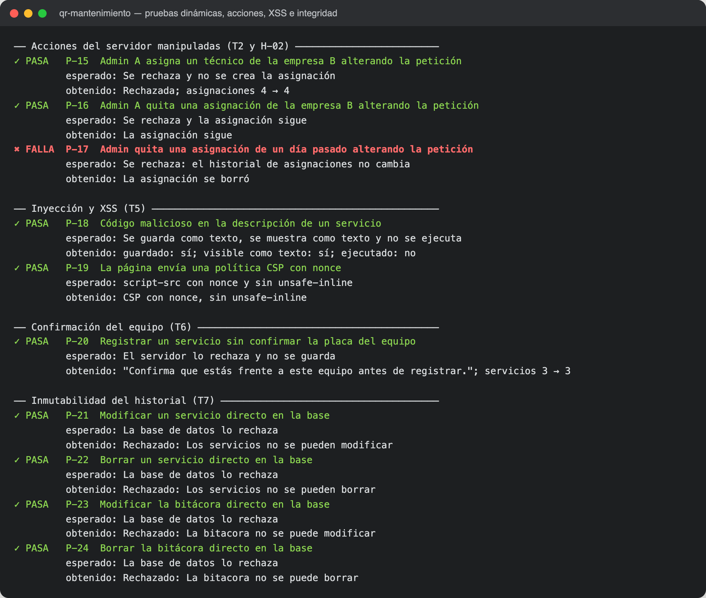
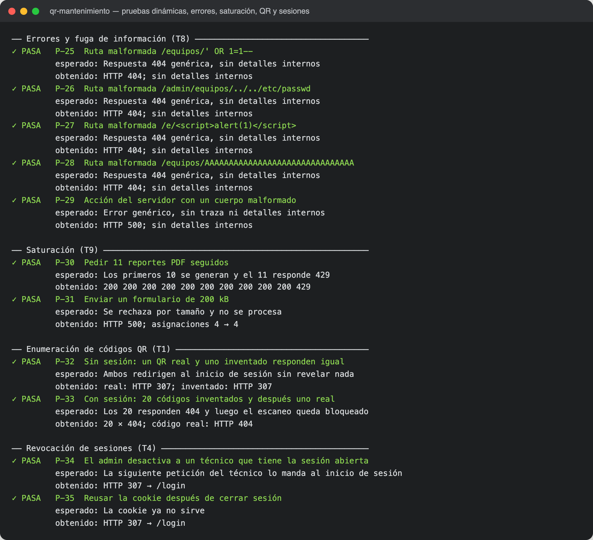
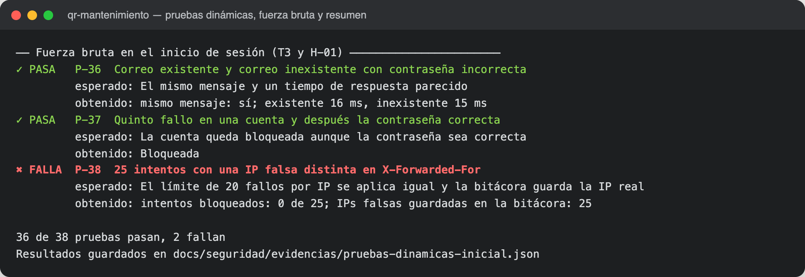
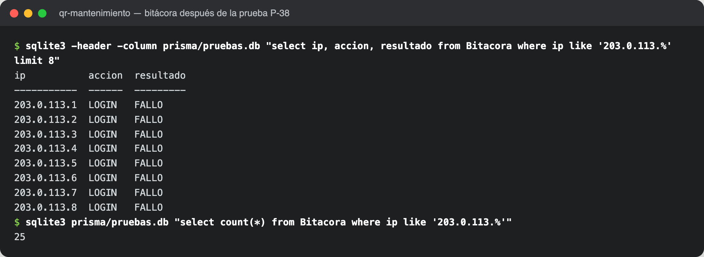

# 5. Pruebas dinámicas de seguridad

En estas pruebas atacamos el sistema mientras está funcionando, para comprobar con hechos que las defensas del diseño se comportan como esperábamos. Las ejecutamos el 25 de noviembre de 2026.

## Cómo las hicimos

Escribimos un programa que hace 38 ataques distintos contra una copia local del sistema. Usa una base de datos aparte, con dos empresas de prueba, para no llenar de registros la bitácora de desarrollo, que no se puede borrar.

El programa trabaja como lo haría un atacante. Inicia sesión desde un navegador real, intenta entrar a páginas de otra empresa, modifica las peticiones que envía la pantalla para pedir cosas que no debería poder pedir, escribe código malicioso en los formularios e intenta cambiar la base de datos directamente. En cada caso compara lo que pasó con lo que debería pasar.

Para repetir las pruebas:

```bash
./scripts/preparar-pruebas.sh
npm run build
DATABASE_URL=file:./pruebas.db npx next start -p 3100
npm run test:seguridad
```

## Resultados

De las 38 pruebas, 36 pasaron y 2 fallaron. Todas las defensas del diseño resistieron, y las dos pruebas que fallaron confirman justamente los hallazgos H-01 y H-02 que encontramos en la revisión del código.

| Amenaza | Qué probamos | Pasan | Fallan |
| --- | --- | --- | --- |
| T1 | Adivinar códigos QR | 2 | 0 |
| T2 | Entrar a datos de otra empresa, de otro rol o de equipos no asignados | 14 | 0 |
| T3 | Adivinar contraseñas | 2 | 0 |
| T4 | Robo de sesión, cuentas dadas de baja y cierre de sesión | 4 | 0 |
| T5 | Código malicioso en los formularios | 2 | 0 |
| T6 | Registrar un servicio sin confirmar el equipo | 1 | 0 |
| T7 | Modificar o borrar el historial | 4 | 0 |
| T8 | Peticiones mal formadas que podrían revelar información | 5 | 0 |
| T9 | Saturar el sistema con muchas peticiones | 2 | 0 |
| H-01 | Inventar la dirección IP en cada intento | 0 | 1 |
| H-02 | Borrar asignaciones de días pasados | 0 | 1 |









## Hallazgos que se confirmaron

**H-02.** Tomamos la petición que quita una asignación de hoy, le cambiamos el identificador por el de una asignación de ayer y la reenviamos. El servidor la aceptó y la borró. La restricción solo existía en la pantalla, no en el servidor.

**H-01.** Hicimos 25 intentos fallidos de inicio de sesión, cada uno con una dirección IP inventada. Ninguno se bloqueó, aunque el límite es de 20 intentos por dirección, y la bitácora guardó las 25 direcciones falsas. Esto resultó más grave de lo que pensábamos, porque además del límite de intentos afecta a la bitácora: quien ataca decide qué dirección queda registrada.



## Observaciones

- En la prueba P-31 enviamos un formulario de 200 kB. El sistema lo rechazó como esperábamos, pero respondió con un error 500 en lugar del 413 que corresponde. No revela información, así que lo dejamos solo como observación.
- En la prueba P-36 medimos cuánto tarda el inicio de sesión con un correo que existe y con uno que no. Tardaron 16 y 15 milisegundos, así que el tiempo de respuesta no delata qué cuentas existen.

## Archivos de esta carpeta

- **resultados-inicial.json**: el resultado de cada una de las 38 pruebas, con lo esperado y lo obtenido.
