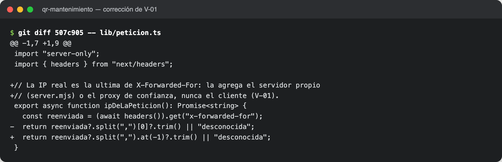
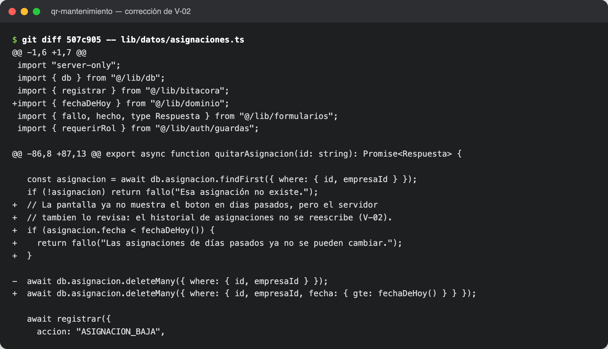
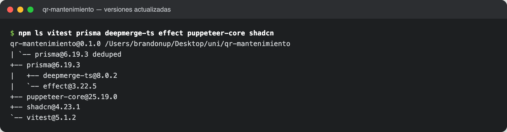
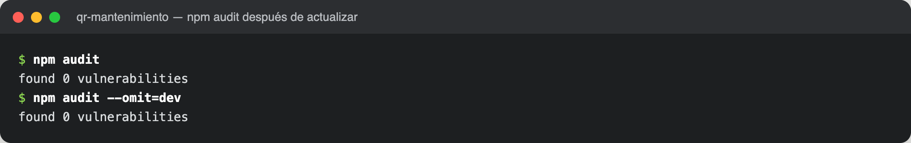
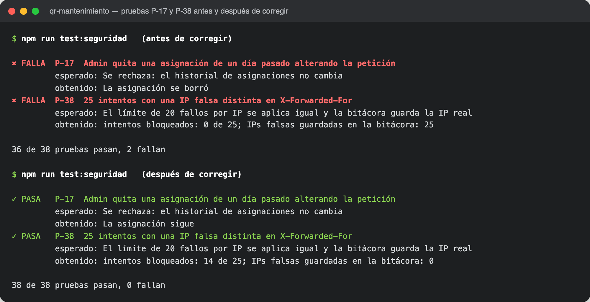
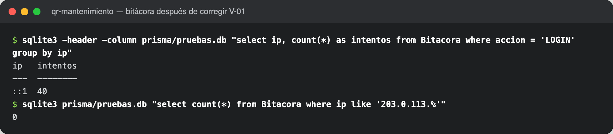
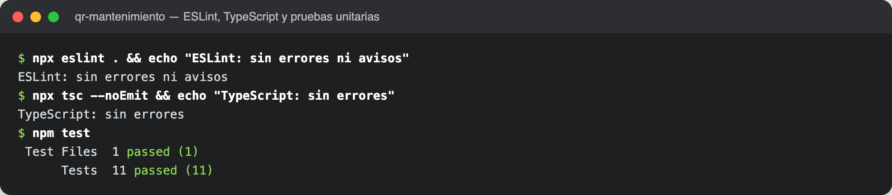

# 7. Corrección y revalidación de vulnerabilidades

Aquí mostramos cómo corregimos las siete vulnerabilidades abiertas del registro y cómo comprobamos que las correcciones funcionan, repitiendo las mismas pruebas que las habían detectado.

## Qué corregimos

| ID | Problema | Qué hicimos |
| --- | --- | --- |
| V-01 | La IP se tomaba de una cabecera que el cliente puede inventar | Agregamos un servidor pequeño, server.mjs, que reemplaza esa cabecera por la dirección real de la conexión antes de que la petición llegue a la aplicación |
| V-02 | Se podían quitar asignaciones de días pasados | El servidor ahora revisa la fecha y las rechaza, igual que ya lo hacía la pantalla |
| V-03 y V-05 | vitest y tinypool vulnerables | Actualizamos vitest de la versión 3.2.7 a la 5.1.2 |
| V-04 | deepmerge-ts y effect vulnerables dentro de Prisma | Forzamos sus versiones corregidas sin cambiar de versión mayor de Prisma |
| V-06 | minimatch vulnerable | Lo actualizamos a la versión 11.0.9 |
| V-07 | shadcn instalada como librería de producción | La movimos a las librerías de desarrollo |

## Algo que no esperábamos

Al revisar otra vez las librerías nos dimos cuenta de que puppeteer-core, la que agregamos para automatizar las pruebas y generar estas imágenes, traía 9 vulnerabilidades altas. La herramienta que usábamos para probar la seguridad había metido sus propios riesgos. La actualizamos a la versión 25.19.0 y desaparecieron. Nos quedó claro que las herramientas de desarrollo también hay que revisarlas.

## Volvimos a probar

Repetimos las 38 pruebas dinámicas con una base de datos nueva y ahora pasan todas. Las dos que antes fallaban, P-17 y P-38, ya pasan.

En la bitácora ya no aparece ninguna de las direcciones inventadas. Todos los intentos quedaron registrados con la dirección real.

También revisamos que las correcciones no rompieran nada: el análisis del código sigue limpio y las pruebas unitarias pasan.

| ID | Cómo lo comprobamos | Antes | Después |
| --- | --- | --- | --- |
| V-01 | Prueba P-38 y consulta a la bitácora | Falla | Pasa |
| V-02 | Prueba P-17 | Falla | Pasa |
| V-03 a V-07 | npm audit | 17 vulnerabilidades | Ninguna |

## Archivos de esta carpeta

- **resultados-revalidacion.json**: el resultado de las 38 pruebas después de corregir.
