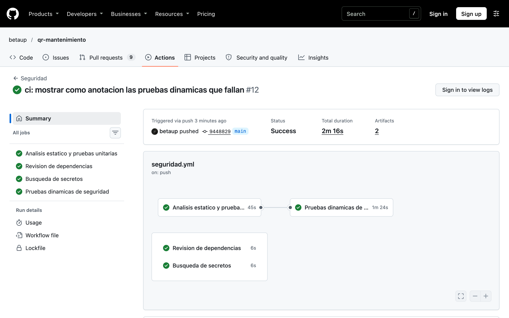
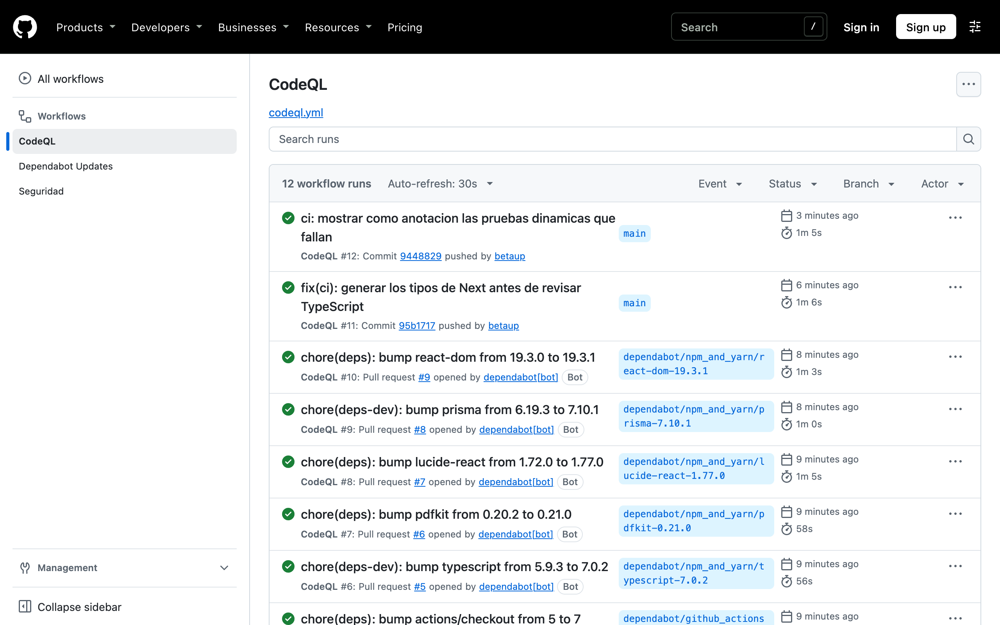
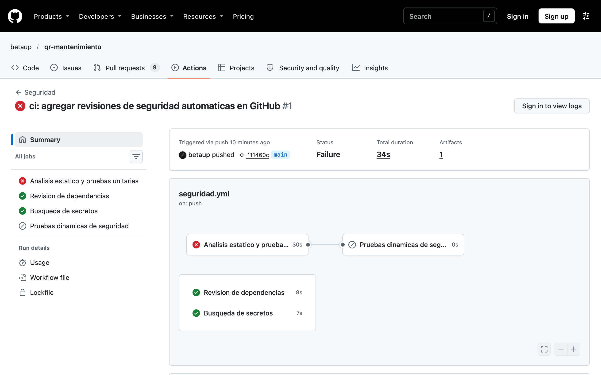
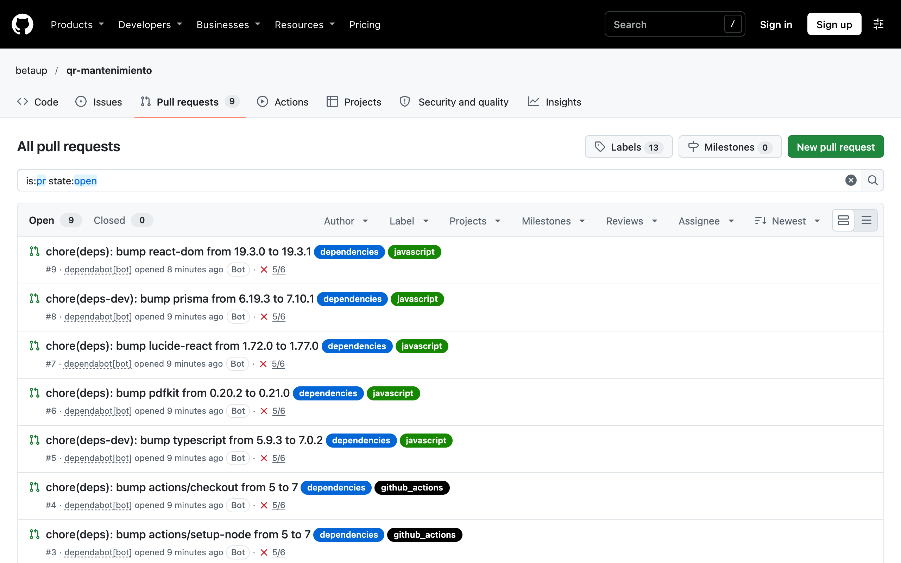

# 9. Integración continua y automatización de seguridad

Aquí mostramos cómo las revisiones de seguridad que hicimos a mano en las partes anteriores ahora se ejecutan solas en GitHub cada vez que subimos cambios.

## Qué configuramos

| Archivo | Qué hace | Cuándo corre |
| --- | --- | --- |
| .github/workflows/seguridad.yml | Revisa el código, las librerías, busca secretos y corre las 38 pruebas dinámicas | En cada push a main, en cada pull request, cada lunes y a mano |
| .github/workflows/codeql.yml | Análisis estático de GitHub con las reglas de seguridad extendidas | En cada push, pull request y cada semana |
| .github/dependabot.yml | Revisa si hay versiones nuevas de las librerías y de las acciones de GitHub | Cada semana |

El workflow de seguridad tiene cuatro trabajos:

| Trabajo | Qué revisa | Herramienta |
| --- | --- | --- |
| Análisis estático y pruebas unitarias | Reglas de seguridad de ESLint, tipos de TypeScript, pruebas unitarias y que el proyecto compile | ESLint, tsc, Vitest, next build |
| Revisión de dependencias | Que ninguna librería tenga vulnerabilidades moderadas o mayores | npm audit |
| Búsqueda de secretos | Que no se haya subido ninguna contraseña o llave en todo el historial | gitleaks |
| Pruebas dinámicas de seguridad | Levanta la aplicación con una base de datos nueva y corre las 38 pruebas | scripts/pruebas-seguridad.mjs con Chrome |

Si cualquiera falla, el commit o el pull request queda marcado en rojo. Las pruebas dinámicas usan una contraseña distinta y aleatoria en cada ejecución, así no hay ninguna contraseña guardada en el repositorio.

## Resultado

Los cuatro trabajos pasan y el análisis de CodeQL también termina correctamente.

## Lo que encontramos al configurarlo

La primera vez que subimos los workflows, el paso de TypeScript falló aunque en nuestras computadoras pasaba. Next genera algunos tipos en la carpeta .next, que existe en local pero no en un servidor limpio. Lo corregimos generando esos tipos antes de revisar.

Esto nos mostró algo útil del CI: revisa el proyecto desde cero, sin lo que ya teníamos en nuestras máquinas.

También hicimos que, cuando una prueba dinámica falle, aparezca en el resumen del trabajo cuál fue y por qué, sin tener que abrir el registro completo.

## Dependabot

En cuanto lo activamos, Dependabot abrió 9 pull requests con actualizaciones. Algunas son cambios de versión mayor, como Prisma 7 o TypeScript 7, que pueden romper el proyecto. Por eso no las aceptamos sin revisarlas: cada pull request pasa primero por el mismo workflow de seguridad y solo se integra si todo pasa.

