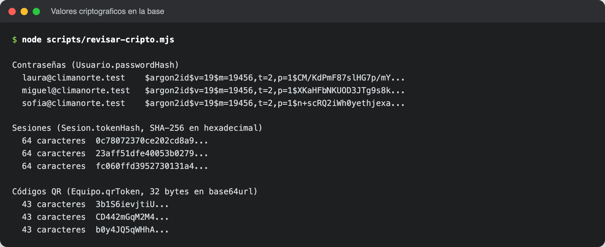

# 10. Revisión de dependencias y mecanismos criptográficos

Aquí revisamos que las librerías que usamos sean confiables y estén al día, y que los mecanismos de hash y de tokens estén bien configurados.

## Dependencias

En producción usamos 17 librerías directas, que con las que ellas traen suman 130 paquetes.

| Revisión | Resultado |
| --- | --- |
| npm audit | 0 vulnerabilidades. El CI lo corre en cada push y cada lunes |
| Scripts que se ejecutan al instalar | Solo los tienen prisma, @prisma/client y @prisma/engines, la librería oficial de la base |
| Versiones nuevas | Dependabot las propone cada semana y pasan por el workflow de seguridad antes de aceptarlas |
| Versiones exactas | El CI instala con npm ci, que respeta package-lock.json |

## Mecanismos criptográficos

No hicimos ningún algoritmo propio. Todo usa el módulo crypto de Node.js o una librería reconocida.

| Uso | Mecanismo | Por qué así |
| --- | --- | --- |
| Contraseñas | Argon2id con m=19456 KiB, t=2, p=1 y sal por cuenta | Son los parámetros mínimos que recomienda OWASP |
| Token de sesión | 256 bits de randomBytes | Generador criptográfico, imposible de adivinar |
| Token en la base | SHA-256 del token | Quien lea la base no puede usar la sesión |
| Token del QR | 256 bits de randomBytes en base64url | No se puede enumerar y no tiene relación con el id del equipo |
| Nonce de la CSP | crypto.randomUUID en cada petición | Nadie lo conoce de antemano |
| Transporte | Cabecera HSTS y cookie Secure | El cifrado lo da el certificado del servidor donde se publique |

## Evidencia

Con el script scripts/revisar-cripto.mjs consultamos cómo quedan guardados estos valores en la base de pruebas. Cada contraseña tiene su propia sal, los hashes de sesión tienen 64 caracteres (SHA-256) y los tokens de QR tienen 43.

Al hacer esta revisión notamos que las cuentas de prueba compartían el mismo hash, porque el script que llena la base calculaba uno solo para todas. Lo corregimos para que cada cuenta tenga su propia sal.
