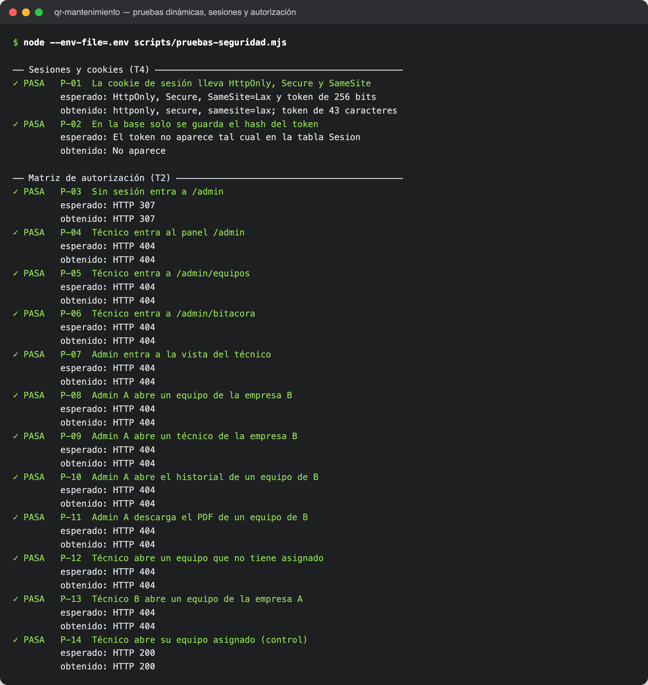
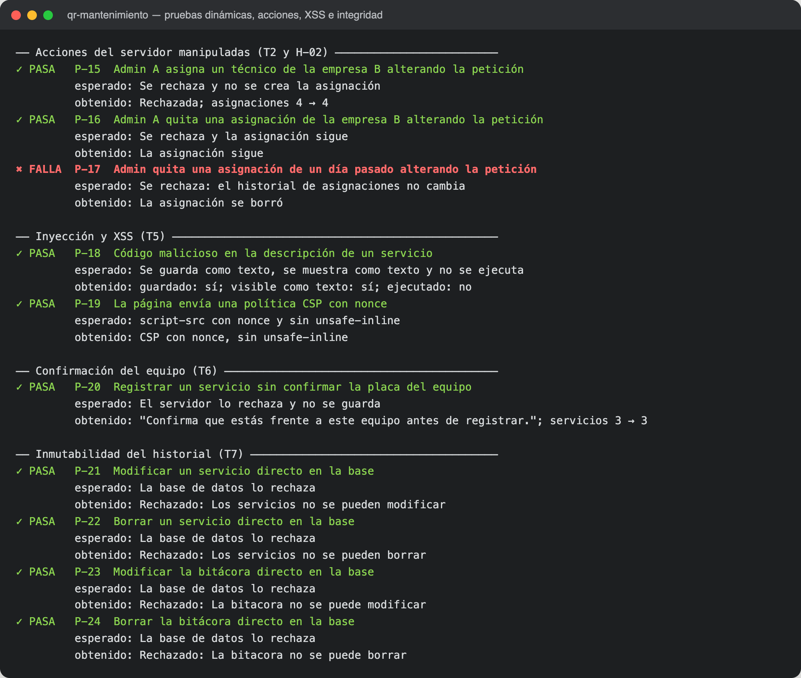
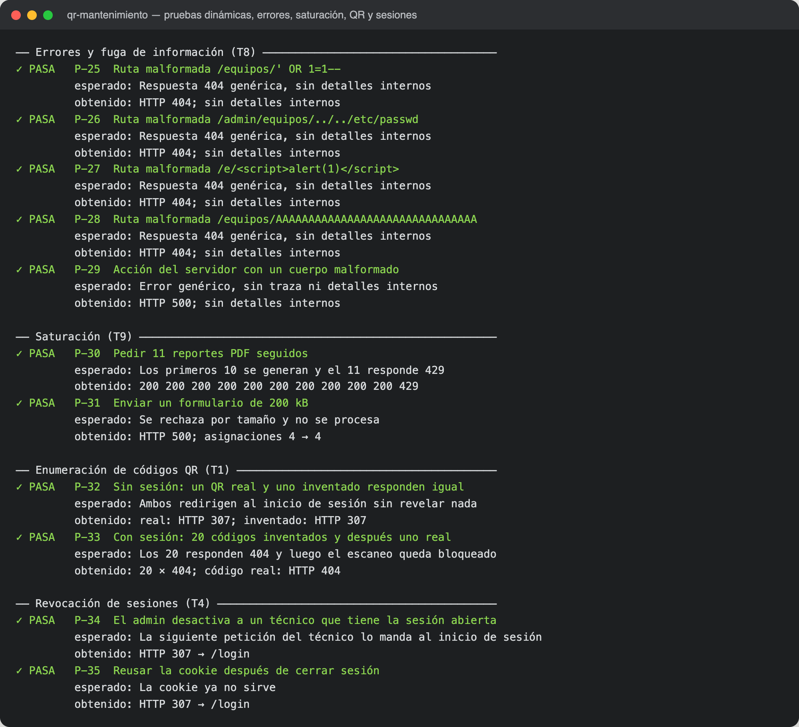
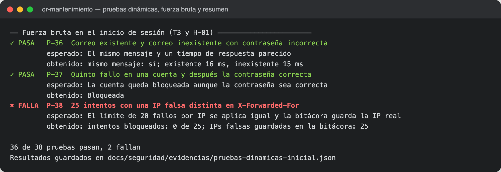
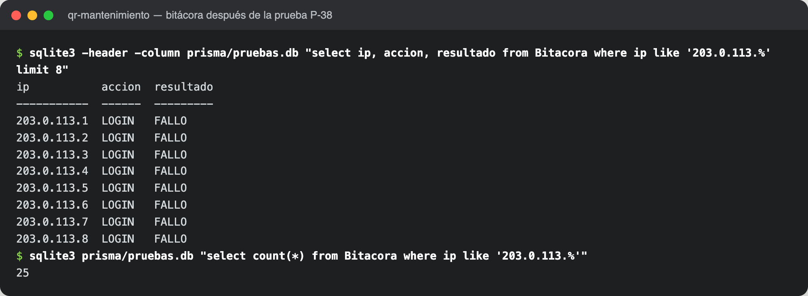

# 5. Pruebas dinámicas de seguridad

Fecha de ejecución: 25 de noviembre de 2026. Resultados completos en `resultados-inicial.json`, en esta misma carpeta.

## Cómo repetirlas

Las pruebas usan una base de datos propia, `prisma/pruebas.db`, para no llenar de registros la bitácora de desarrollo, que no se puede borrar.

```bash
./scripts/preparar-pruebas.sh
npm run build
DATABASE_URL=file:./pruebas.db npx next start -p 3100
npm run test:seguridad
```

El script inicia sesión de verdad desde un navegador Chrome sin interfaz, captura las acciones del servidor que dispara la pantalla y las reenvía con datos cambiados, como lo haría un atacante con las herramientas de desarrollo. Para la inmutabilidad intenta modificar la base de datos directamente.

## Resumen

**36 de 38 pruebas pasan.** Las dos que fallan confirman los hallazgos H-01 y H-02 de la revisión manual.

| Amenaza | Qué se probó | Pasan | Fallan |
| --- | --- | --- | --- |
| T1 | Enumeración de códigos QR | 2 | 0 |
| T2 | Acceso entre empresas, roles y equipos no asignados | 14 | 0 |
| T3 | Fuerza bruta y enumeración de cuentas | 2 | 0 |
| T4 | Cookies, revocación y cierre de sesión | 4 | 0 |
| T5 | Inyección, XSS y política CSP | 2 | 0 |
| T6 | Confirmación del equipo antes de registrar | 1 | 0 |
| T7 | Inmutabilidad de servicios y bitácora | 4 | 0 |
| T8 | Rutas y peticiones malformadas | 5 | 0 |
| T9 | Tope de reportes y tamaño de formularios | 2 | 0 |
| H-01 | IP falsificada con X-Forwarded-For | 0 | 1 |
| H-02 | Asignaciones de días pasados | 0 | 1 |






## Detalle

| ID | Amenaza | Prueba | Resultado obtenido | Resultado |
| --- | --- | --- | --- | --- |
| P-01 | T4 | La cookie de sesión lleva HttpOnly, Secure y SameSite | httponly, secure, samesite=lax; token de 43 caracteres | Pasa |
| P-02 | T4 | En la base solo se guarda el hash del token | No aparece | Pasa |
| P-03 | T2 | Sin sesión entra a /admin | HTTP 307 | Pasa |
| P-04 | T2 | Técnico entra al panel /admin | HTTP 404 | Pasa |
| P-05 | T2 | Técnico entra a /admin/equipos | HTTP 404 | Pasa |
| P-06 | T2 | Técnico entra a /admin/bitacora | HTTP 404 | Pasa |
| P-07 | T2 | Admin entra a la vista del técnico | HTTP 404 | Pasa |
| P-08 | T2 | Admin A abre un equipo de la empresa B | HTTP 404 | Pasa |
| P-09 | T2 | Admin A abre un técnico de la empresa B | HTTP 404 | Pasa |
| P-10 | T2 | Admin A abre el historial de un equipo de B | HTTP 404 | Pasa |
| P-11 | T2 | Admin A descarga el PDF de un equipo de B | HTTP 404 | Pasa |
| P-12 | T2 | Técnico abre un equipo que no tiene asignado | HTTP 404 | Pasa |
| P-13 | T2 | Técnico B abre un equipo de la empresa A | HTTP 404 | Pasa |
| P-14 | T2 | Técnico abre su equipo asignado (control) | HTTP 200 | Pasa |
| P-15 | T2 | Admin A asigna un técnico de la empresa B alterando la petición | Rechazada; asignaciones 4 → 4 | Pasa |
| P-16 | T2 | Admin A quita una asignación de la empresa B alterando la petición | La asignación sigue | Pasa |
| P-17 | H-02 | Admin quita una asignación de un día pasado alterando la petición | La asignación se borró | **Falla** |
| P-18 | T5 | Código malicioso en la descripción de un servicio | guardado: sí; visible como texto: sí; ejecutado: no | Pasa |
| P-19 | T5 | La página envía una política CSP con nonce | CSP con nonce, sin unsafe-inline | Pasa |
| P-20 | T6 | Registrar un servicio sin confirmar la placa del equipo | "Confirma que estás frente a este equipo antes de registrar."; servicios 3 → 3 | Pasa |
| P-21 | T7 | Modificar un servicio directo en la base | Rechazado: Los servicios no se pueden modificar | Pasa |
| P-22 | T7 | Borrar un servicio directo en la base | Rechazado: Los servicios no se pueden borrar | Pasa |
| P-23 | T7 | Modificar la bitácora directo en la base | Rechazado: La bitacora no se puede modificar | Pasa |
| P-24 | T7 | Borrar la bitácora directo en la base | Rechazado: La bitacora no se puede borrar | Pasa |
| P-25 | T8 | Ruta malformada /equipos/' OR 1=1-- | HTTP 404; sin detalles internos | Pasa |
| P-26 | T8 | Ruta malformada /admin/equipos/../../etc/passwd | HTTP 404; sin detalles internos | Pasa |
| P-27 | T8 | Ruta malformada /e/<script>alert(1)</script> | HTTP 404; sin detalles internos | Pasa |
| P-28 | T8 | Ruta malformada /equipos/AAAAAAAAAAAAAAAAAAAAAAAAAAAAAAA | HTTP 404; sin detalles internos | Pasa |
| P-29 | T8 | Acción del servidor con un cuerpo malformado | HTTP 500; sin detalles internos | Pasa |
| P-30 | T9 | Pedir 11 reportes PDF seguidos | 200 200 200 200 200 200 200 200 200 200 429 | Pasa |
| P-31 | T9 | Enviar un formulario de 200 kB | HTTP 500; asignaciones 4 → 4 | Pasa |
| P-32 | T1 | Sin sesión: un QR real y uno inventado responden igual | real: HTTP 307; inventado: HTTP 307 | Pasa |
| P-33 | T1 | Con sesión: 20 códigos inventados y después uno real | 20 × 404; código real: HTTP 404 | Pasa |
| P-34 | T4 | El admin desactiva a un técnico que tiene la sesión abierta | HTTP 307 → /login | Pasa |
| P-35 | T4 | Reusar la cookie después de cerrar sesión | HTTP 307 → /login | Pasa |
| P-36 | T3 | Correo existente y correo inexistente con contraseña incorrecta | mismo mensaje: sí; existente 16 ms, inexistente 15 ms | Pasa |
| P-37 | T3 | Quinto fallo en una cuenta y después la contraseña correcta | Bloqueada | Pasa |
| P-38 | H-01 | 25 intentos con una IP falsa distinta en X-Forwarded-For | intentos bloqueados: 0 de 25; IPs falsas guardadas en la bitácora: 25 | **Falla** |

## Hallazgos confirmados

- **H-02 (P-17).** Al reenviar la acción de quitar una asignación con el identificador de una asignación de ayer, el servidor la borró. La restricción de fechas solo existía en la pantalla.
- **H-01 (P-38).** 25 intentos fallidos, cada uno con una IP inventada en `X-Forwarded-For`, y ninguno se bloqueó. La bitácora guardó las 25 IPs falsas, así que quien ataca decide qué dirección queda registrada.



## Observaciones

- **P-31.** El formulario de 200 kB se rechazó, pero con un error 500 en lugar de 413. El registro del servidor muestra el motivo real (`Body exceeded 100kb limit`). No filtra información; se registra como observación informativa.
- **P-36.** Correo existente e inexistente tardan 16 y 15 ms. El hash de relleno evita que el tiempo delate qué cuentas existen.
